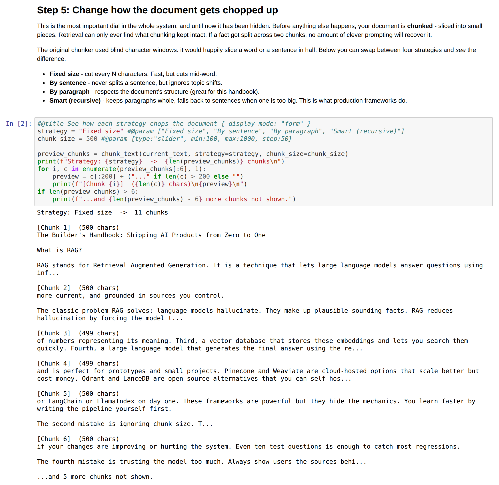

# rag-workshop

A notebook that teaches RAG (retrieval-augmented generation) to non-technical people. It is a single Colab notebook: run one cell, ask questions about a sample document, then upload your own and watch how retrieval and hallucination work. No coding experience needed.



## Run it

Open [rag_workshop.ipynb](rag_workshop.ipynb) in Google Colab:

https://colab.research.google.com/github/glebstarchikov/rag-workshop/blob/main/rag_workshop.ipynb

Get a free Google AI API key from https://aistudio.google.com/apikey (no credit card). Run the first cell and paste the key when it asks. That cell is done when it prints `All set. Move to the next cell.` Run the next cell. It answers "What is RAG?" from the sample handbook and shows the chunks it used.

The upload cell uses Colab's file picker (`google.colab.files`). The other cells are ordinary Python.

Cells that ask a question call Gemini (`gemini-2.5-flash`). They need your key, and this repo does not store one, so GitHub Actions does not run them. Actions installs the same packages as the first cell and runs setup, the chunk preview, and the on-disk Chroma cell.

## Run that check locally

From a clean clone:

```bash
python -m venv .venv
source .venv/bin/activate
python -m pip install google-genai chromadb sentence-transformers pypdf
python scripts/execute_notebook.py
```

Success prints `Embedding model ready.`, `All set. Move to the next cell.`, a chunk preview that starts `Strategy: Fixed size`, `Saved 11 chunks to ./rag_db`, and `OK`.

## Stack

Jupyter notebook, Google Gemini API, ChromaDB, sentence-transformers.

## Status

Maintained, November 2026.

## License

[MIT](LICENSE)

---

Part of what I build at [glebstarchikov.nl](https://glebstarchikov.nl).
